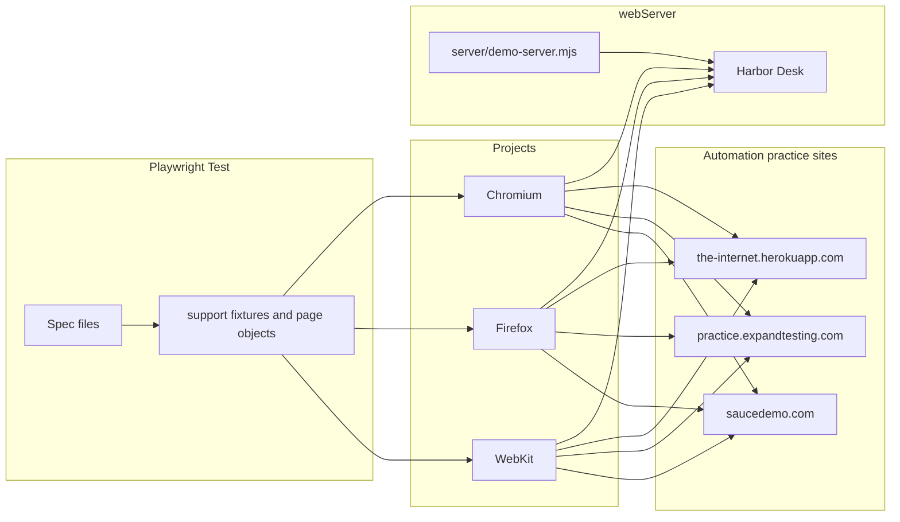
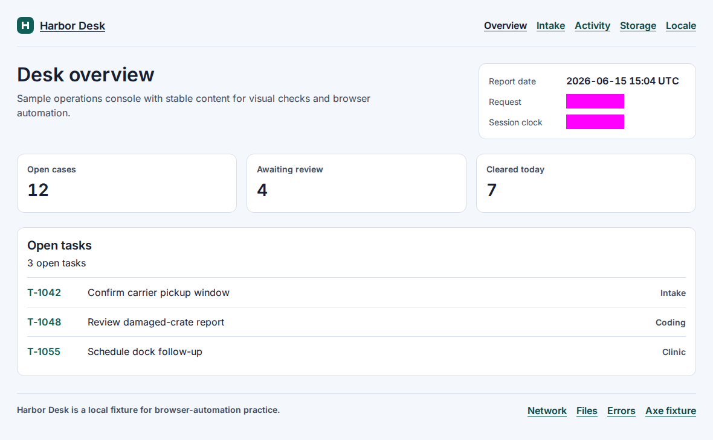
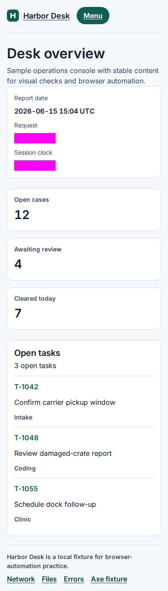
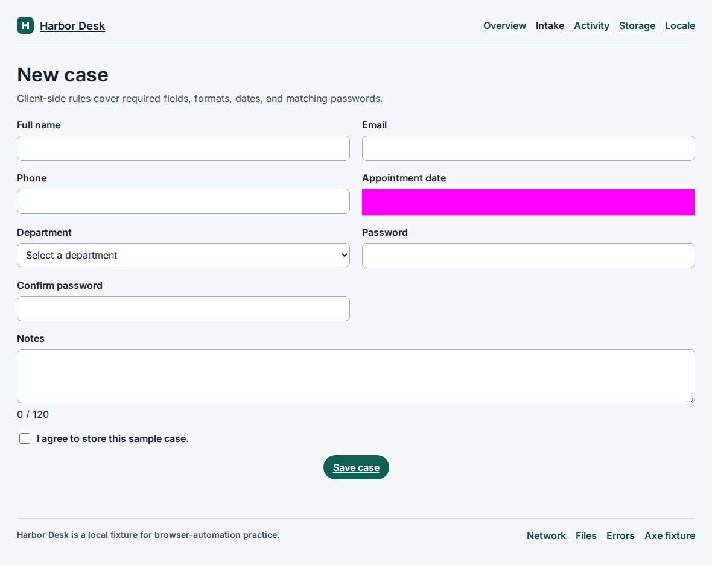
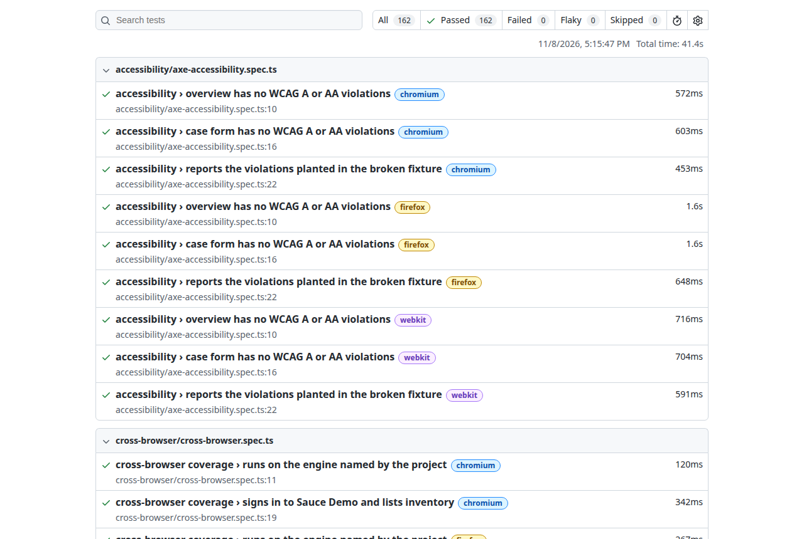

# Playwright Advanced Testing

The suite runs on Chromium, Firefox, and WebKit. Deterministic scenarios use **Harbor Desk**, a small local fixture. Flows that are better demonstrated on a public practice site use [The Internet](https://the-internet.herokuapp.com), [Expand Testing](https://practice.expandtesting.com), and [Sauce Demo](https://www.saucedemo.com).

[](https://github.com/hassanmehmoodd/playwright-advanced-testing/actions/workflows/playwright.yml)
[](https://playwright.dev)
[](https://www.typescriptlang.org/)
[](https://nodejs.org/)
[](LICENSE)

## Capabilities

| #   | Technique                              | Spec                                                                                             |
| --- | -------------------------------------- | ------------------------------------------------------------------------------------------------ |
| 1   | Visual regression                      | [`tests/visual/visual-regression.spec.ts`](tests/visual/visual-regression.spec.ts)               |
| 2   | Accessibility (`@axe-core/playwright`) | [`tests/accessibility/axe-accessibility.spec.ts`](tests/accessibility/axe-accessibility.spec.ts) |
| 3   | Cross-browser                          | [`tests/cross-browser/cross-browser.spec.ts`](tests/cross-browser/cross-browser.spec.ts)         |
| 4   | File upload and download               | [`tests/file-transfer/upload-download.spec.ts`](tests/file-transfer/upload-download.spec.ts)     |
| 5   | Network mocking                        | [`tests/network/network-mocking.spec.ts`](tests/network/network-mocking.spec.ts)                 |
| 6   | Browser storage and sessions           | [`tests/storage/browser-storage.spec.ts`](tests/storage/browser-storage.spec.ts)                 |
| 7   | Responsive layout and device emulation | [`tests/responsive/responsive-viewports.spec.ts`](tests/responsive/responsive-viewports.spec.ts) |
| 8   | Form validation                        | [`tests/forms/form-validation.spec.ts`](tests/forms/form-validation.spec.ts)                     |
| 9   | Dynamic elements                       | [`tests/dynamic/dynamic-elements.spec.ts`](tests/dynamic/dynamic-elements.spec.ts)               |
| 10  | Error handling                         | [`tests/errors/error-handling.spec.ts`](tests/errors/error-handling.spec.ts)                     |
| 11  | Localization                           | [`tests/localization/localization.spec.ts`](tests/localization/localization.spec.ts)             |
| 12  | Reusable utilities                     | [`support/`](support/)                                                                           |
| 13  | CI execution                           | [`.github/workflows/playwright.yml`](.github/workflows/playwright.yml)                           |

Playwright fans the whole suite out to three projects, so every spec above runs on Chromium, Firefox, and WebKit.

## Architecture



Harbor Desk is started by `webServer` before the tests and is shut down afterwards. Secrets stay out of the suite: Databricks-style tokens are not used here, and the only credentials are the public Sauce Demo practice user published by that site.

## Folder structure

```text
.
├── .github/workflows/playwright.yml   # CI: push, pull request, workflow_dispatch
├── docs/images/                       # Screenshots captured from a real run
├── fixtures/demo-app/                 # Harbor Desk pages, font, and sample file
├── server/demo-server.mjs             # Static host plus a few JSON routes
├── support/                           # Fixtures, page objects, and helpers
├── test-data/                         # File used by the upload specs
├── tests/
│   ├── accessibility/
│   ├── cross-browser/
│   ├── dynamic/
│   ├── errors/
│   ├── file-transfer/
│   ├── forms/
│   ├── localization/
│   ├── network/
│   ├── responsive/
│   ├── storage/
│   └── visual/                        # Specs and committed *-linux.png baselines
├── playwright.config.ts
└── package.json
```

## 1. Visual regression

`toHaveScreenshot` compares Harbor Desk against committed baselines. Dynamic regions (a random request id and a ticking session clock) are masked in magenta. The native date control on the case form is masked as well, because browser chrome around that input is not stable. Animations are disabled, the caret is hidden, and screenshots are taken at CSS pixel scale.

The comparison allows `maxDiffPixelRatio: 0.01` so subpixel font hinting between Ubuntu hosts does not fail the build. A layout shift still exceeds that ratio.

Baselines are named `*-linux.png` and were generated on Ubuntu 24.04, the same OS family as CI (`runs-on: ubuntu-24.04`). A macOS or Windows checkout will look for its own platform suffix and should not replace the Linux files.

Update them on Ubuntu 24.04:

```bash
npm run test:update-snapshots
```

Or run the GitHub Actions workflow manually with **Regenerate Linux visual baselines** enabled, download the `visual-snapshots` artifact, and commit the PNGs.

Spec: [`tests/visual/visual-regression.spec.ts`](tests/visual/visual-regression.spec.ts)



## 2. Accessibility

`@axe-core/playwright` scans the overview and the case form for WCAG 2.0/2.1 A and AA violations and expects none. A separate fixture page plants an empty button, an image with no alt, an unlabeled field, and low-contrast text. The spec asserts those rule ids are reported, so a broken axe integration cannot hide behind a page that happens to be clean.

Spec: [`tests/accessibility/axe-accessibility.spec.ts`](tests/accessibility/axe-accessibility.spec.ts)

## 3. Cross-browser

`playwright.config.ts` defines `chromium`, `firefox`, and `webkit`. One spec reads `navigator.userAgent` and checks that it matches the project that launched the browser, then signs in to Sauce Demo with the public practice user and asserts the inventory renders.

Spec: [`tests/cross-browser/cross-browser.spec.ts`](tests/cross-browser/cross-browser.spec.ts)

## 4. File upload and download

Harbor Desk accepts a multipart upload and returns the filename and byte size. A second test downloads `release-notes.txt` through Playwright's download event and reads the saved file. The same techniques are repeated on The Internet's uploader and Expand Testing's stable `some-file.txt` link.

Spec: [`tests/file-transfer/upload-download.spec.ts`](tests/file-transfer/upload-download.spec.ts)

## 5. Network mocking

The network page renders `GET /api/tasks`. The spec covers:

- `route.fulfill` with a JSON body the server does not return
- `route.abort('failed')` and the offline message
- a fulfilled `500`
- `route.fetch()` followed by `route.fulfill` to inject a task into the live payload
- `page.routeFromHAR` against [`tests/network/fixtures/tasks.har`](tests/network/fixtures/tasks.har)

The HAR entry is pinned to `http://127.0.0.1:4173/api/tasks`. Keep `DEMO_BASE_URL` at the default when running that test.

Spec: [`tests/network/network-mocking.spec.ts`](tests/network/network-mocking.spec.ts)

## 6. Browser storage and sessions

The storage page writes `localStorage`, `sessionStorage`, and a JavaScript-visible cookie. Tests check that all three survive a reload, then save `storageState` and open a new context. Local storage and the cookie come back. Session storage does not, which is how Playwright's storage state works. A fourth test sets an `httpOnly` cookie with `context.addCookies` and checks that the server receives it while `document.cookie` does not.

Spec: [`tests/storage/browser-storage.spec.ts`](tests/storage/browser-storage.spec.ts)

## 7. Responsive testing

At 1280px the summary cards sit on one row and the menu button is hidden. At 390px the cards stack and the menu button reveals the primary links. A third test applies Playwright's iPhone 13 device descriptor (viewport, user agent, touch, mobile) inside the current browser project. That is device emulation, not a separate physical device lab.

Spec: [`tests/responsive/responsive-viewports.spec.ts`](tests/responsive/responsive-viewports.spec.ts)



## 8. Form validation

The case form checks required fields, email and phone formats, a Unicode letter pattern, password length and composition, a matching confirmation, a 120-character note, consent, and appointment rules. `page.clock` is frozen at 15 June 2026 so "today", past dates, and weekends do not depend on the wall clock. Errors set `aria-invalid` and move focus to the first invalid control.

Spec: [`tests/forms/form-validation.spec.ts`](tests/forms/form-validation.spec.ts)



## 9. Dynamic elements

Local coverage waits out a one-second `/api/activity` response, clicks a button inside an open shadow root, reads a nested shadow tree, types in an iframe via `frameLocator`, and re-queries a row after the node is replaced. Public practice coverage waits for The Internet's delayed "Hello World!", reads its shadow DOM slots, and adds then removes an element on Expand Testing.

Spec: [`tests/dynamic/dynamic-elements.spec.ts`](tests/dynamic/dynamic-elements.spec.ts)

## 10. Error handling

Harbor Desk covers `alert`, `confirm`, and `prompt`, a `console.error`, an uncaught exception, a real HTTP 500, an aborted request, and a 404 page. The Internet supplies its classic JavaScript alert and the 500 status page. Expand Testing's onload error is observed through `pageerror`.

Spec: [`tests/errors/error-handling.spec.ts`](tests/errors/error-handling.spec.ts)

## 11. Localization

`test.use` sets `locale` and `timezoneId` for New York (`en-US`), Paris (`fr-FR`), and Tokyo (`ja-JP`). The page formats one fixed instant, 15:00 UTC on 15 June 2026, with `Intl`. Assertions use `formatToParts` written into data attributes, so grouping spaces and browser-specific date strings do not make the test brittle. In Tokyo that instant is 16 June at 00:00.

Spec: [`tests/localization/localization.spec.ts`](tests/localization/localization.spec.ts)

## 12. Reusable utilities

| Piece                                                                      | Role                                                  |
| -------------------------------------------------------------------------- | ----------------------------------------------------- |
| [`support/fixtures.ts`](support/fixtures.ts)                               | Extends the test with `caseForm` and `storageDesk`    |
| [`support/pages/case-form.page.ts`](support/pages/case-form.page.ts)       | Page object for the case form                         |
| [`support/pages/storage-desk.page.ts`](support/pages/storage-desk.page.ts) | Page object for storage                               |
| [`support/helpers/accessibility.ts`](support/helpers/accessibility.ts)     | Axe wrappers                                          |
| [`support/helpers/network.ts`](support/helpers/network.ts)                 | JSON fulfill and third-party abort                    |
| [`support/helpers/browser.ts`](support/helpers/browser.ts)                 | User-agent engine check and `storageState` contexts   |
| [`support/constants.ts`](support/constants.ts)                             | Origins, public Sauce Demo user, optional `.env` load |

## 13. CI

[`.github/workflows/playwright.yml`](.github/workflows/playwright.yml) runs on push to `main`, pull requests targeting `main`, and `workflow_dispatch`. Concurrency cancels an in-progress run for the same ref. The job uses Node 22 with the npm cache, installs browsers with OS dependencies, runs the full three-browser suite, and always uploads `playwright-report` and `test-results`.

The runner is pinned to `ubuntu-24.04` so visual baselines stay on one OS image. Retries are 1 in CI only. Traces are kept on the first retry. Video is off to save minutes.

## Installation

Requires Node.js 22 or newer.

```bash
git clone https://github.com/hassanmehmoodd/playwright-advanced-testing.git
cd playwright-advanced-testing
npm ci
npx playwright install --with-deps
```

Copy `.env.example` to `.env` only if you want to override the defaults. The file has no secrets. `SAUCE_USERNAME` and `SAUCE_PASSWORD` are the public practice values from saucedemo.com.

## Execution

```bash
npm test                      # Chromium, Firefox, and WebKit
npm run test:chromium
npm run test:firefox
npm run test:webkit
npm run test:headed
npm run test:ui
npm run lint
npm run typecheck
npm run format:check
npm run demo                  # Harbor Desk at http://127.0.0.1:4173
```

## Reporting

```bash
npm run report
```

That opens the last HTML report. A report from the local three-browser run is below: 162 passed, 0 failed, 41.4s.



CI uploads the same HTML report and the `test-results` directory (traces and screenshots when a retry or failure happens) on every run, including failed ones.

## Author

**Hassan Mehmood**, Senior SQA Automation Engineer

- GitHub: [github.com/hassanmehmoodd](https://github.com/hassanmehmoodd)
- LinkedIn: [linkedin.com/in/hassan-mehmood-hm2](https://www.linkedin.com/in/hassan-mehmood-hm2/)

## License

MIT. Copyright 2026 Hassan Mehmood. See [LICENSE](LICENSE).

The Inter font files under `fixtures/demo-app/fonts/` are licensed under the SIL Open Font License. See `fixtures/demo-app/fonts/OFL.txt`.
